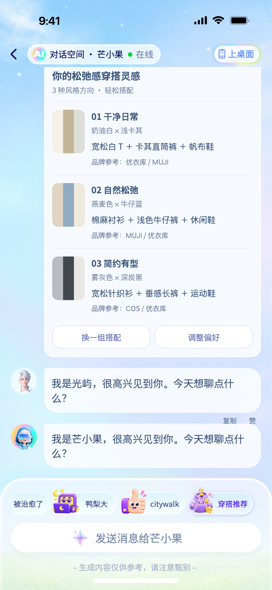

# 芒小果 · MangoTV AI Assistant

基于 Figma 主视觉制作的移动端交互原型。支持透明人物循环动画、欢迎文案打字、标签微动、横向话题切换、对话、穿搭任务与辅助面板。

## 在线查看

- [交互 Demo](https://raddie-jean.github.io/MangoTV-AI-Assistant-/)
- [页面入口与交互说明](https://raddie-jean.github.io/MangoTV-AI-Assistant-/interaction-guide.html)
- [浏览全部源码](https://github.com/Raddie-Jean/MangoTV-AI-Assistant-)
- [交互规格](docs/interaction-spec.md)

> 在线地址需要仓库开启 GitHub Pages 后才可访问。首次发布配置见 [部署说明](docs/deployment.md)，部署成功后无需登录即可分享。



## 推荐体验路径

1. 进入页面，查看人物循环、文案打字与标签微动。
2. 向左拖动或滑动底部话题栏，点击「穿搭推荐」。桌面也支持滚轮、触控板和方向键。
3. 查看用户提问、人物回应，以及「理解偏好 → 筛选品牌 → 组合搭配」三步任务。
4. 任务中可以停止、继续；完成后可以换一组、调整偏好。
5. 通过「上桌面」体验历史、角色选择、心绪卡、心情笔记；通过历史提示查看本次会话。

人物和欢迎区随对话上滑，底部输入区域保留。每次刷新从开场演示；笔记保存在当前浏览器，不上传。

## 查看源码

| 文件 | 作用 |
| --- | --- |
| [index.html](index.html) | 主页面与 Figma 图层结构 |
| [style.css](style.css) | 视觉、手机缩放、人物裁切、层级与微动效 |
| [app.js](app.js) | 对话、话题拖动、任务状态和面板流转 |
| [character-config.js](character-config.js) | 人物 GIF、循环与裁切参数 |
| [interaction-guide.html](interaction-guide.html) | 八个可直接打开的状态及交互说明 |
| [assets/](assets/) | 当前版本的本地图片、字体与动画 |
| [docs/](docs/) | 交互规格、部署、素材与验收说明 |
| [tests/](tests/) | 浏览器交付检查 |

## 本地预览

下载仓库 ZIP 后可直接用浏览器打开 `index.html`。推荐使用本地静态服务器，便于测试剪贴板等浏览器功能：

```sh
git clone https://github.com/Raddie-Jean/MangoTV-AI-Assistant-.git
cd MangoTV-AI-Assistant-
node scripts/serve.cjs
```

打开 `http://127.0.0.1:4173/`。网站本身没有运行时依赖和构建步骤。

## 运行检查

需要 Node.js；测试依赖只用于浏览器验证，不会被网站加载。

```sh
npm install
npx playwright install chromium
npm test
```

检查包括：鼠标拖动不误发送、点击话题能发送、任务停止/继续、历史提示随内容上滑、角色切换、GIF 循环、手机布局和缺失图片。可通过 `CHROME_PATH` 指定已安装的 Chrome。

## 原型范围

- 对话、品牌参考和任务进度由本地脚本模拟，不连接真实 AI、搜索、购买或账号服务。
- 桌面入口是 Demo 内部功能面板，不修改系统桌面。
- 人物 GIF 保留原始帧和透明度，采用固定上半身裁切；显示层调亮，不重编码。
- 手机短屏会整体等比缩小，两侧可能留白；系统软键盘行为仍需真机检验。
- Figma 及提供的素材用于本次原型展示。素材不视为开源许可，使用范围详见 [素材说明](docs/assets.md)。
